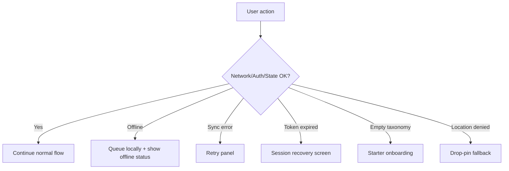
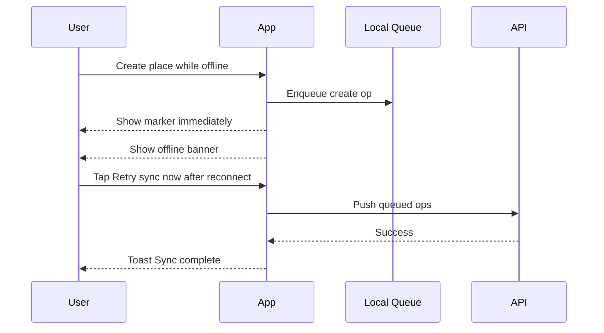
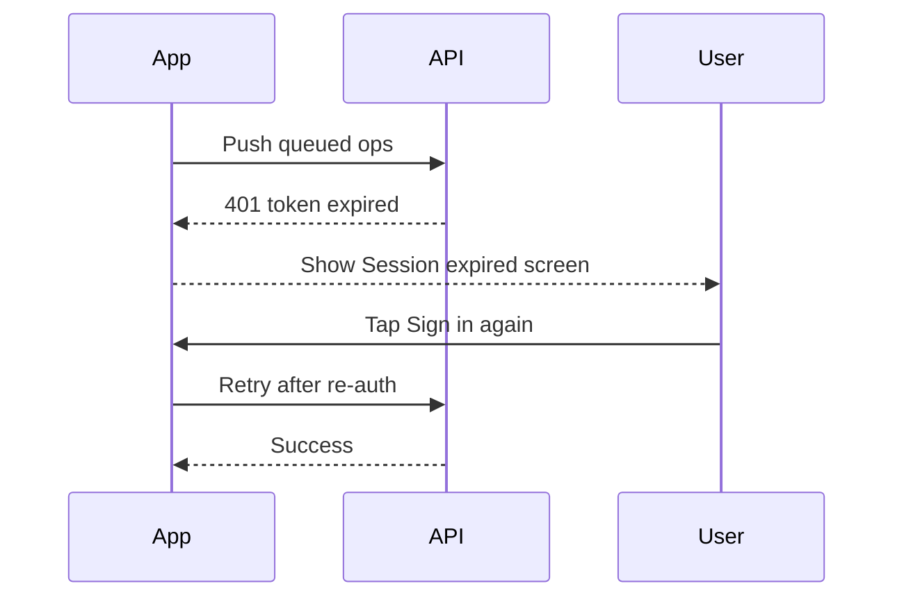

# Mycelia v1 Edge-Case Screen Mockups

This document specifies medium-fidelity edge-case interactions that complement the primary flow.

Companion specs:
- docs/design/v1-medium-fidelity-ui-spec.md
- docs/design/v1-screen-flow-mockups.md
- docs/design/v1-flutter-ux-contract.md

## 1. Scope

Covered edge cases:
1. Offline mode with queued mutations.
2. Sync failure and retry recovery.
3. Auth token expiry and session recovery.
4. Empty taxonomy onboarding.
5. Permission denial fallback (location).

Out of scope:
- Full conflict resolution editor.
- Multi-account switching UX.

## 2. Edge-Case Navigation Overview



## 3. Screen EC-1: Offline Banner + Queue Status

Use on Map Home while offline.

```text
+--------------------------------+
| Mycelia        [Profile]       |
| Offline mode                   |
| Changes will sync later        |
| [View queued changes]          |
|                                |
|         (map canvas)           |
|                                |
|                        [ + ]   |
+--------------------------------+
```

Layout and behavior:
- Banner height: 56.
- Position: below top bar, above filter chips.
- Priority: persistent while offline.
- Tapping View queued changes opens EC-2.

Copy:
- Title: Offline mode
- Body: Changes will sync later.
- CTA: View queued changes

## 4. Screen EC-2: Queued Changes Panel

Bottom sheet listing pending operations.

```text
+--------------------------------+
| Queued changes (7)             |
|                                |
| • Create place: Cedar Grove    |
| • Add tag: species/morel       |
| • Save filter: Fall spots      |
| • Edit place: Ridge trail      |
|                                |
| Last sync: 12 min ago          |
| [ Retry sync now ]             |
| [ Close ]                      |
+--------------------------------+
```

States:
- Idle offline.
- Reconnecting.
- Syncing.
- Sync partially failed.

Behavior rules:
- Retry sync now enabled only when connectivity returns.
- Queue entries are informational in v1 (no per-item edit).
- If queue depth > 99, show 99+.

## 5. Screen EC-3: Sync Failure Retry Sheet

Shown when sync attempt fails after reconnect.

```text
+--------------------------------+
| Sync needs attention           |
|                                |
| 3 changes could not sync.      |
| Nothing is lost.               |
|                                |
| Reason: Network timeout        |
| Last attempt: just now         |
|                                |
| [ Retry now ]                  |
| [ Try in background ]          |
| [ View details ]               |
+--------------------------------+
```

Copy variants by reason:
- Network timeout
- Server unavailable
- Temporary auth issue
- Unknown temporary error

Behavior:
- Retry now performs immediate push/pull.
- Try in background closes sheet and keeps exponential backoff worker active.
- View details opens EC-4.

## 6. Screen EC-4: Sync Details (Lightweight)

```text
+--------------------------------+
| Sync details                   |
|                                |
| Failed operations              |
| 1) Create place: Cedar Grove   |
|    Timeout                     |
| 2) Update tag: terrain/mossy   |
|    Server unavailable          |
| 3) Save filter: Fall spots     |
|    Timeout                     |
|                                |
| [ Retry all ]                  |
| [ Back ]                       |
+--------------------------------+
```

Rules:
- No destructive actions.
- Keep user confidence language.
- Avoid showing raw stack traces.

## 7. Screen EC-5: Session Expired Recovery

Full-screen interrupt when token refresh fails.

```text
+--------------------------------+
| Session expired                |
|                                |
| Your session ended.            |
| Sign in to continue syncing.   |
| Local changes are safe.        |
|                                |
| [ Sign in again ]              |
| [ Continue offline ]           |
+--------------------------------+
```

Behavior:
- Sign in again routes to Clerk and returns to previous screen.
- Continue offline preserves local write ability and queueing.
- Protected server actions are deferred until auth restored.

## 8. Screen EC-6: Empty Taxonomy Onboarding

Shown in Tags Manager when no tags exist.

```text
+--------------------------------+
| No tags yet                    |
|                                |
| Start with starter tags, or    |
| create your own from scratch.  |
|                                |
| [ Import all starter tags ]    |
| [ Import by category ]         |
| [ Create first tag ]           |
| [ Skip for now ]               |
+--------------------------------+
```

Rules:
- Skip keeps taxonomy empty.
- Create first tag opens Create Tag.
- Import by category opens category picker modal.

## 9. Screen EC-7: Import by Category Modal

```text
+--------------------------------+
| Choose categories              |
|                                |
| [x] Species                    |
| [ ] Terrain                    |
| [x] Condition                  |
| [ ] Season                     |
|                                |
| [ Import selected ]            |
| [ Cancel ]                     |
+--------------------------------+
```

Validation:
- If none selected: Select at least one category.

## 10. Screen EC-8: Location Permission Denied Card

Shown after denied location request from add flow.

```text
+--------------------------------+
| Location permission is off     |
|                                |
| You can still add a place by   |
| dropping a pin on the map.     |
|                                |
| [ Drop pin on map ]            |
| [ Open settings ]              |
| [ Cancel ]                     |
+--------------------------------+
```

Behavior:
- Drop pin on map enters map pin mode immediately.
- Open settings deep links to OS app settings.

## 11. State Matrix

## 11.1 Offline and Sync
- Offline + queue empty:
  - Show offline banner only.
- Offline + queue has items:
  - Show offline banner + queue count.
- Online + sync failed:
  - Show EC-3 once per failure burst.
- Online + sync recovered:
  - Dismiss retry sheet, show toast Sync complete.

## 11.2 Auth
- Token refresh success:
  - Silent continue.
- Token refresh failed:
  - Show EC-5.
- Re-auth success:
  - Resume queued sync automatically.

## 11.3 Taxonomy Empty
- First open and no tags:
  - Show EC-6.
- User skips:
  - Show lightweight reminder in Tags manager header.

## 12. Microcopy Set (Canonical)

- Offline mode
- Changes will sync later.
- View queued changes
- Queued changes
- Retry sync now
- Sync needs attention
- Nothing is lost.
- Session expired
- Local changes are safe.
- Sign in again
- Continue offline
- No tags yet
- Import all starter tags
- Import by category
- Create first tag
- Skip for now
- Location permission is off
- Drop pin on map

## 13. Interaction Sequences

### 13.1 Offline create then recover



### 13.2 Token expiry during sync



## 14. Acceptance Criteria

1. Users can continue creating places/tags/filters offline without data loss.
2. Sync failure messaging does not imply user data loss.
3. Session expiry flow allows offline continuation and clear re-auth path.
4. Empty taxonomy users have clear first-step choices.
5. Location denial still results in a successful place creation path via drop pin.
