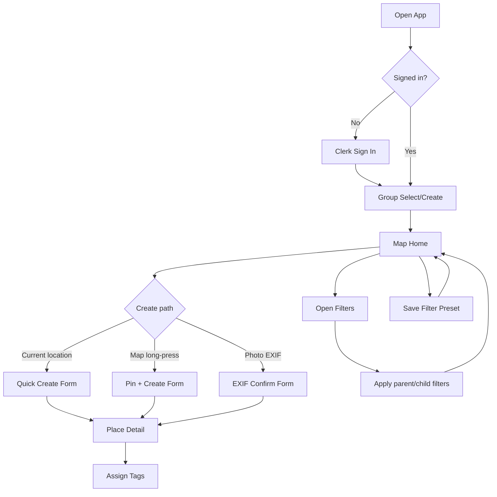
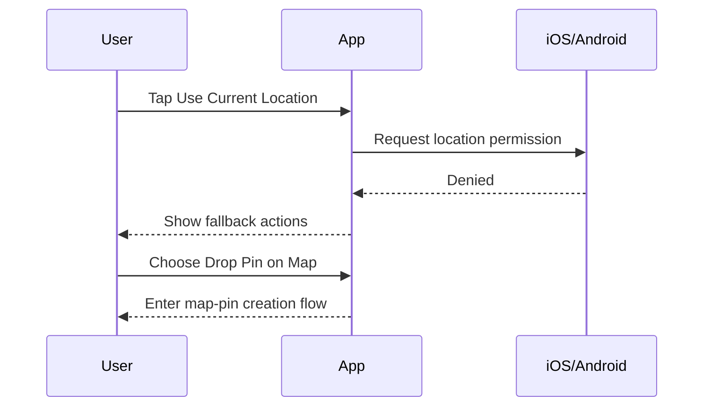
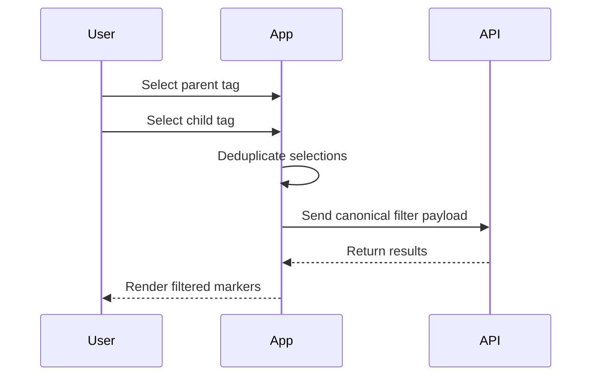

# Mycelia v1 Application Flow + Screen Mockups

This document turns the v1 product decisions into a concrete interaction flow with low-fidelity screen mockups.

## 1. End-to-End Flow (Primary Path)



## 2. Navigation Model

- Bottom-level anchor: Map Home.
- Secondary overlays: filter panel, add-place action sheet, place detail bottom sheet.
- Full-screen stacks: auth/group setup, tags manager, advanced taxonomy editor.

## 3. Screen Mockups (Lo-Fi)

### Screen A: Sign In

```text
+--------------------------------+
| Mycelia                        |
|                                |
| Find and organize mushroom     |
| places with your group         |
|                                |
| [ Continue with Clerk ]        |
|                                |
| Terms • Privacy                |
+--------------------------------+
```

Interaction notes:
- Tap Continue: starts Clerk flow.
- Success: go to Group Select/Create.
- Failure: inline error + retry.

### Screen B: Group Select / Create

```text
+--------------------------------+
| Choose Group                   |
|                                |
| Your groups                    |
| [ Forest Crew           > ]    |
| [ Weekend Foragers      > ]    |
|                                |
| ----------------------------   |
| Create new group               |
| [ Group name            ]      |
| [ Create Group ]               |
+--------------------------------+
```

Interaction notes:
- Select existing group: enter Map Home.
- Create Group: POST /v1/groups then enter Map Home.

### Screen C: Map Home (Primary)

```text
+--------------------------------+
| Mycelia        [Profile]       |
| [Filter: Species, Fall] [x]    |
|                                |
|        (map canvas)            |
|   o      oo      o      o      |
|        [cluster 12]            |
|                                |
|                                |
|            [ + ]               |
+--------------------------------+
```

Interaction notes:
- Tap marker or cluster: open place preview/detail.
- Tap filter chip row: open Filters Panel.
- Tap plus button: open Add Place action sheet.
- Long-press map: create from selected coordinate.

### Screen D: Add Place Action Sheet

```text
+--------------------------------+
| Add Place                      |
|                                |
| [ Use Current Location ]       |
| [ Drop Pin on Map ]            |
| [ Import from Photo EXIF ]     |
|                                |
| [ Cancel ]                     |
+--------------------------------+
```

Interaction notes:
- Current location: request permission if needed.
- Drop pin: dismiss sheet and arm long-press mode.
- Photo EXIF: open photo picker.

### Screen E: Quick Create Form

```text
+--------------------------------+
| New Place                      |
|                                |
| Name *                         |
| [                      ]       |
| Description                    |
| [                      ]       |
| Date observed                  |
| [ YYYY-MM-DD           ]       |
|                                |
| Coord: 45.123, -122.456        |
| Accuracy: 9m                   |
|                                |
| [ Save Place ]                 |
+--------------------------------+
```

Interaction notes:
- Save: local write first, queue sync op, show marker immediately.
- Missing optional facets do not block save.

### Screen F: Place Detail

```text
+--------------------------------+
| Chanterelle Ridge              |
| 45.123, -122.456               |
|                                |
| Tags                            |
| [ + Add Tags ]                 |
| [species: chanterelle]         |
| [terrain: mossy]               |
|                                |
| System facets (read-only)      |
| observed_date: 2026-11-02      |
| temperature_c: --              |
| weather_condition: --          |
| Some environmental facets      |
| unavailable                    |
+--------------------------------+
```

Interaction notes:
- Add Tags opens tag picker.
- Availability note appears only here.
- No blocking warnings for missing system facets.

### Screen G: Tags Manager (Default)

```text
+--------------------------------+
| Tags                           |
| [ Search tags...         ]     |
|                                |
| Level 1 / Level 2 focus        |
| species                         |
|   - chanterelle                |
|   - morel                      |
| terrain                         |
|   - mossy                      |
|                                |
| [ + Create Tag ]               |
| [ Import Starter Tags ]        |
| [ Advanced Hierarchy ]*        |
+--------------------------------+
```

Interaction notes:
- Advanced Hierarchy button shown only to owner/editor.
- Viewers can browse and apply existing tags but not create deep structure.

### Screen H: Create Tag

```text
+--------------------------------+
| Create Tag                     |
|                                |
| Name *                         |
| [                      ]       |
| Category *                     |
| ( ) species  ( ) terrain       |
| ( ) condition ( ) season       |
| Icon (optional)                |
| [ choose icon ]                |
| Color (optional)               |
| [ choose color ]               |
|                                |
| [ Save Tag ]                   |
+--------------------------------+
```

Interaction notes:
- Category is required.
- If icon is omitted, assign category default icon.
- Duplicate names are rejected with inline suggestion.

### Screen I: Filters Panel

```text
+--------------------------------+
| Filters                        |
|                                |
| Include tags                   |
| [species] [terrain] [season]   |
|                                |
| Exclude tags                   |
| [condition]                    |
|                                |
| Date range                     |
| [from]   [to]                  |
|                                |
| Parent tag selected:           |
| Includes descendants (auto)    |
|                                |
| [ Apply ]   [ Save Preset ]    |
+--------------------------------+
```

Interaction notes:
- No toggle for descendant expansion in v1.
- Parent + child overlap deduplicates automatically.

### Screen J: Save Filter Preset

```text
+--------------------------------+
| Save Filter Preset             |
|                                |
| Preset name                    |
| [ Fall Chanterelle Spots ]     |
|                                |
| Summary                        |
| Include: species, terrain      |
| Date: Sep-Nov                  |
|                                |
| [ Save ]                       |
+--------------------------------+
```

Interaction notes:
- Preset appears as quick chip on Map Home.

## 4. Critical Interaction Scenarios

### Scenario 1: Permission denied for current location



### Scenario 2: Parent + child selected in filter



## 5. What To Prototype First

1. Map Home + Add Place action sheet + Quick Create form.
2. Place Detail + Tag assignment picker.
3. Filters Panel + Save Preset flow.
4. Tags Manager default mode, then advanced hierarchy mode.

## 6. Validation Checklist for Interaction Clarity

- Can a new user create a place within 15-20 seconds from map open?
- Is the difference between default tags UI and advanced hierarchy obvious?
- Do users understand that parent filters include descendants automatically?
- Is missing system facet data perceived as non-blocking context?
- Can users recover quickly from denied permissions?
